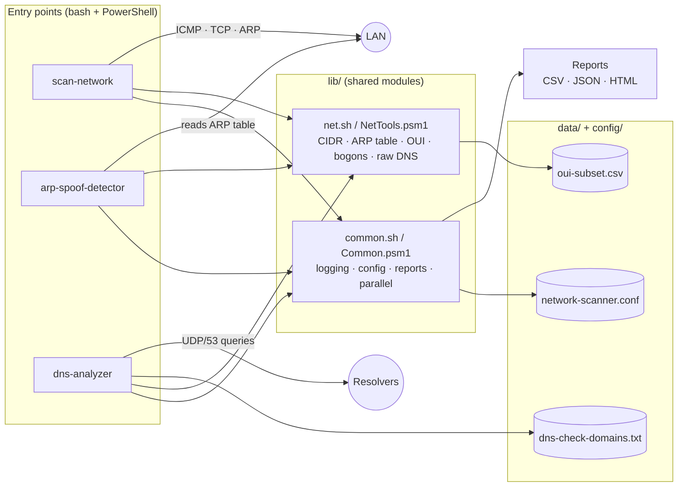
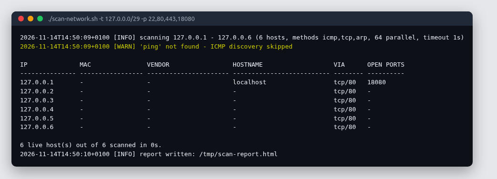
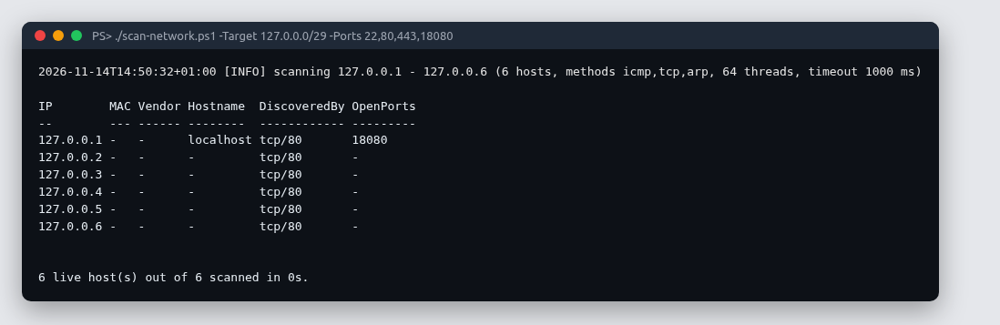
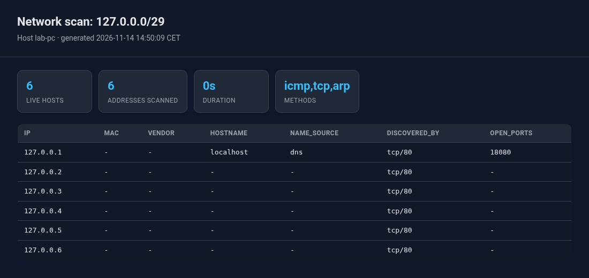
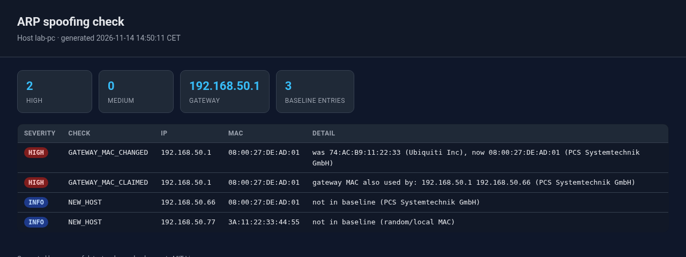
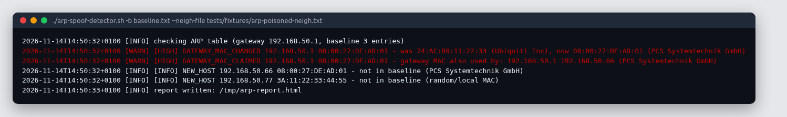
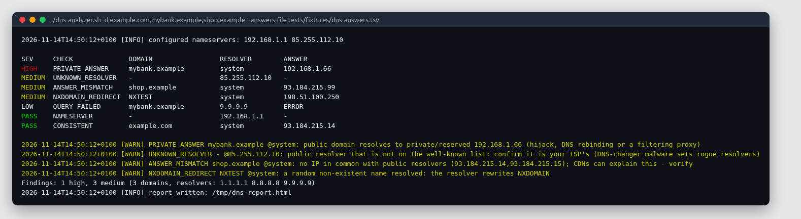

<div align="center">

# network-scanner

**Find every device on your LAN, see who made it and what it exposes, and catch ARP spoofing and DNS hijacking, in PowerShell or bash.**

[](https://github.com/Arnold-RG/network-scanner/actions/workflows/ci.yml)
[](LICENSE)
[](#requirements)
[](#requirements)
[](#requirements)

Part of the **Networking & Security Toolkit** by Arnold Rurangwa:
[overview](https://github.com/Arnold-RG/Arnold-RG/blob/main/security-tools.md) ·
**network-scanner** ·
[port-scanner](https://github.com/Arnold-RG/port-scanner) ·
[network-monitor](https://github.com/Arnold-RG/network-monitor) ·
[security-hardening-checker](https://github.com/Arnold-RG/security-hardening-checker) ·
[log-analyzer](https://github.com/Arnold-RG/log-analyzer)

</div>

---

## Contents

- [Quick start](#quick-start)
- [Features](#features)
- [Architecture](#architecture)
- [Screenshots](#screenshots)
- [Usage](#usage)
- [Configuration reference](#configuration-reference)
- [Requirements](#requirements)
- [Testing](#testing)
- [Limitations](#limitations)
- [Legal and ethical use](#legal-and-ethical-use)

## Quick start

```bash
git clone https://github.com/Arnold-RG/network-scanner.git && cd network-scanner
./scan-network.sh -t 192.168.1.0/24 -o lan.html          # Linux / macOS / WSL
pwsh ./scan-network.ps1 -Target 192.168.1.0/24 -OutputPath lan.html   # or Windows PowerShell: .\scan-network.ps1 ...
```

Open `lan.html` in a browser for the report. Replace `192.168.1.0/24` with your own network.

## Features

| Tool | What it does |
|------|--------------|
| **scan-network** | Host discovery with three methods: ICMP echo, TCP connect (an open **or refused** port proves the host is up) and the ARP/neighbour table (finds hosts that block both). MAC address and **OUI vendor** lookup (about 12,700 vendor prefixes bundled), and locally administered (random) MACs are labelled. Hostnames via **DNS**, **NetBIOS** (`nmblookup` / `nbtstat`) and **mDNS** (`avahi-resolve`). Quick top-20 port check. Up to 256 parallel probes (runspace pool / bash job pool). Optional `nmap -sn` discovery. |
| **arp-spoof-detector** | Saves a trusted ARP baseline, then flags **gateway MAC changes** (HIGH), the **gateway's MAC claimed by another IP** (HIGH), duplicate MACs, changed host MACs and new hosts. One-shot or `--watch` mode, de-duplicated alerts, syslog via `logger`, and exit code 1 on HIGH for schedulers. |
| **dns-analyzer** | Compares the system resolver with 1.1.1.1 / 8.8.8.8 / 9.9.9.9 per domain. Flags **private answers for public domains** (hijack or rebinding), **answer mismatches**, **NXDOMAIN redirection**, **rogue public resolvers** in the config (DNS-changer malware) and missing **DNSSEC** validation (AD flag). The PowerShell version builds DNS packets by hand, so it needs no `dig` and runs on any OS. |
| **packet-tracer-lab** | Cisco Packet Tracer lab in two parts: VLANs, DHCP and router-on-a-stick, then hardening with an extended ACL, an SSH-only management VLAN, `login block-for`, port security and DHCP snooping. See [packet-tracer-lab/](packet-tracer-lab/README.md). |

Shared across all tools:

- **Reports:** console table plus **CSV, JSON and a self-contained HTML report** (no JavaScript, no CDN). Repeat `-o` / `-OutputPath` to write several formats.
- **Config file:** `config/network-scanner.conf` (KEY=VALUE), read by both languages without `eval`. Command-line options override it.
- **Logging:** levels DEBUG/INFO/WARN/ERROR, an optional log file, and data on stdout with logs on stderr.
- **Safety:** validated input (CIDR /16-/32, ports, domains), `/8` scans refused, read-only by design.
- **Offline analysis:** `--neigh-file` / `-NeighborFile` and `--answers-file` analyse saved dumps from another machine. The tests use the same path.

## Architecture



```
network-scanner/
├── scan-network.sh / .ps1         host discovery + MAC/vendor/hostname + ports
├── arp-spoof-detector.sh / .ps1   ARP baseline and MITM detection
├── dns-analyzer.sh / .ps1         resolver comparison and DNS config audit
├── lib/                           common.sh, net.sh, Common.psm1, NetTools.psm1
├── config/network-scanner.conf    shared KEY=VALUE configuration
├── data/                          OUI vendor subset, DNS domain list (see data/README.md)
├── packet-tracer-lab/             Cisco lab: VLANs, DHCP, ACL + SSH hardening
├── docs/                          documentation index and screenshots
└── tests/                         run-tests.sh, windows-smoke.ps1, fixtures, fake DNS server
```

## Screenshots

All screenshots are real runs, rendered from the terminal output of the
command shown in each title bar ([how](docs/screenshots/README.md)). The ARP and
DNS examples use the synthetic fixtures in `tests/fixtures/`, because
reproducing an attack on a real LAN is not something to do for a README.

| | |
|---|---|
|  |  |
|  |  |




## Usage

Every tool has built-in help: `./tool.sh -h` or `Get-Help .\tool.ps1 -Full`.

### scan-network

```bash
./scan-network.sh -t 192.168.1.0/24                       # full discovery + top-20 ports
./scan-network.sh -t 192.168.1.0/24 -n -m arp,icmp        # discovery only, no TCP sweep
./scan-network.sh -t 10.0.0.0/28 -p 22,80,443 -j 32 -w 2 -o lan.csv -o lan.json -l scan.log
./scan-network.sh -c config/network-scanner.conf -t 192.168.1.0/24
```

```powershell
.\scan-network.ps1 -Target 192.168.1.0/24 -OutputPath lan.html, lan.csv
.\scan-network.ps1 192.168.1.0/24 | Where-Object Vendor -match 'Raspberry'   # objects on the pipeline
.\scan-network.ps1 -Target 10.0.0.0/28 -Ports 22,3389 -Threads 32 -TimeoutMs 500
```

Real output (loopback range, a test web server on 18080, `ping` not installed on that machine):

```text
$ ./scan-network.sh -t 127.0.0.0/29 -p 22,80,443,18080 -o lan.csv
2026-11-14T14:50:48+0100 [INFO] scanning 127.0.0.1 - 127.0.0.6 (6 hosts, methods icmp,tcp,arp, 64 parallel, timeout 1s)
2026-11-14T14:50:48+0100 [WARN] 'ping' not found - ICMP discovery skipped

IP              MAC               VENDOR                 HOSTNAME                   VIA      OPEN PORTS
--------------- ----------------- ---------------------- -------------------------- -------- ----------
127.0.0.1       -                 -                      localhost                  tcp/80   18080
127.0.0.2       -                 -                      -                          tcp/80   -
127.0.0.3       -                 -                      -                          tcp/80   -
127.0.0.4       -                 -                      -                          tcp/80   -
127.0.0.5       -                 -                      -                          tcp/80   -
127.0.0.6       -                 -                      -                          tcp/80   -

6 live host(s) out of 6 scanned in 0s.
2026-11-14T14:50:48+0100 [INFO] report written: lan.csv
```

`VIA tcp/80` means port 80 actively refused the connection, which proves the
host is up. Loopback has no MAC address, so on a real LAN the MAC and VENDOR
columns fill in from the ARP table.

### arp-spoof-detector

```bash
./arp-spoof-detector.sh --init                        # 1. on a network you trust
./arp-spoof-detector.sh                               # 2. one check (exit 1 on HIGH)
./arp-spoof-detector.sh --watch 15 -l arp.log -o arp.html   # continuous monitoring
```

```powershell
.\arp-spoof-detector.ps1 -InitBaseline
.\arp-spoof-detector.ps1 -WatchSeconds 15 -LogPath arp.log
```

Real output against the poisoned-table fixture (the attacker's MAC took over the gateway IP):

```text
$ ./arp-spoof-detector.sh -b baseline.txt --neigh-file tests/fixtures/arp-poisoned-neigh.txt
[INFO] checking ARP table (gateway 192.168.50.1, baseline 3 entries)
[WARN] [HIGH] GATEWAY_MAC_CHANGED 192.168.50.1 08:00:27:DE:AD:01 - was 74:AC:B9:11:22:33 (Ubiquiti Inc), now 08:00:27:DE:AD:01 (PCS Systemtechnik GmbH)
[WARN] [HIGH] GATEWAY_MAC_CLAIMED 192.168.50.1 08:00:27:DE:AD:01 - gateway MAC also used by: 192.168.50.1 192.168.50.66 (PCS Systemtechnik GmbH)
[INFO] [INFO] NEW_HOST 192.168.50.66 08:00:27:DE:AD:01 - not in baseline (PCS Systemtechnik GmbH)
[INFO] [INFO] NEW_HOST 192.168.50.77 3A:11:22:33:44:55 - not in baseline (random/local MAC)
```

(Timestamps removed from the start of each line.) Run it from cron or Task
Scheduler. Exit code `1` means a HIGH finding.

### dns-analyzer

```bash
./dns-analyzer.sh                                     # domains from data/dns-check-domains.txt
./dns-analyzer.sh -d mybank.example,github.com -r 1.1.1.1,9.9.9.9 -o dns.html
```

```powershell
.\dns-analyzer.ps1 -Domains github.com, microsoft.com -OutputPath dns.html
```

Real output with the fixture answers:

```text
SEV     CHECK              DOMAIN                 RESOLVER        ANSWER
HIGH    PRIVATE_ANSWER     mybank.example         system          192.168.1.66
MEDIUM  UNKNOWN_RESOLVER   -                      85.255.112.10   -
MEDIUM  ANSWER_MISMATCH    shop.example           system          93.184.215.99
MEDIUM  NXDOMAIN_REDIRECT  NXTEST                 system          198.51.100.250
LOW     QUERY_FAILED       mybank.example         9.9.9.9         ERROR
PASS    NAMESERVER         -                      192.168.1.1     -
PASS    CONSISTENT         example.com            system          93.184.215.14

Findings: 1 high, 3 medium (3 domains, resolvers: 1.1.1.1 8.8.8.8 9.9.9.9)
```

On a live run in a sandbox whose DNS goes through a filtering proxy, the tool
correctly reported every public domain resolving to `198.18.0.1` (a reserved
benchmark range) as `PRIVATE_ANSWER`, plus `NXDOMAIN_REDIRECT`.

## Configuration reference

`config/network-scanner.conf` is shared by the bash and PowerShell versions.
Pass it with `-c` / `-ConfigPath`. Command-line options always win.

| Key | Default | Used by | Meaning |
|-----|---------|---------|---------|
| `LOG_LEVEL` | `INFO` | all | `DEBUG`, `INFO`, `WARN`, `ERROR` |
| `LOG_FILE` | *(empty)* | all | Append log lines to this file |
| `PORTS` | top 20 TCP | scan-network | Ports checked on live hosts |
| `JOBS` | `64` | scan-network | Parallel probes (1-256) |
| `TIMEOUT` | `1` | scan-network | Seconds per probe (PowerShell: x1000 ms) |
| `METHODS` | `icmp,tcp,arp` | scan-network | Discovery methods |
| `TCP_DISCOVERY_PORTS` | `80,443,22,445,139,3389` | scan-network | Ports used to prove a host is alive |
| `OUI_FILE` | `data/oui-subset.csv` | scan, arp | `prefix,vendor` CSV, which can be swapped for the full IEEE list |
| `RESOLVE_NETBIOS` / `RESOLVE_MDNS` | `1` | scan-network | Extra hostname lookups when the tools exist |
| `ARP_BASELINE` | `arp-baseline.txt` | arp-spoof-detector | Baseline file |
| `ARP_INTERVAL` | `30` | arp-spoof-detector | Seconds between checks in watch mode |
| `DNS_RESOLVERS` | `1.1.1.1,8.8.8.8,9.9.9.9` | dns-analyzer | Resolvers to compare with |
| `DNS_DOMAINS_FILE` | `data/dns-check-domains.txt` | dns-analyzer | Domains to check |

Set `REPORT_HOSTNAME` in the environment to label HTML reports with a
different machine name.

## Requirements

| | PowerShell | bash |
|---|---|---|
| Runtime | Windows PowerShell 5.1 or PowerShell 7+ (Windows, Linux, macOS) | bash 4.3+, coreutils `timeout` |
| Required extras | none | none |
| Optional | `nbtstat` (built into Windows) | `ping`, `ip`, `getent`/`host`, `nmblookup`, `avahi-resolve`, `dig`, `nmap`, `logger` |
| Privileges | none | none (`nmap -sn` gives better results as root) |

## Testing

```bash
bash tests/run-tests.sh      # 27 checks: localhost scans, fixtures, bash vs PowerShell parity
```

CI ([workflow](.github/workflows/ci.yml)) runs on every push:

1. **ShellCheck** on every `.sh` file and **PSScriptAnalyzer** on every PowerShell file, with zero findings allowed.
2. **Tests on Ubuntu** for bash and PowerShell 7. The bash and PowerShell versions must give identical findings on the same fixtures. A local fake DNS server checks the hand-written DNS parser (CNAME, name compression, AD flag).
3. **Windows PowerShell 5.1 smoke test on `windows-latest`** ([tests/windows-smoke.ps1](tests/windows-smoke.ps1)). It covers the localhost scan, `Get-NetNeighbor`, `Get-NetRoute`, `Get-DnsClientServerAddress` and live ARP and DNS checks.

## Limitations

- IPv4 only. Prefixes from /16 to /32 are accepted, and larger ranges are refused on purpose.
- MAC addresses only exist for hosts on **your own segment**. Hosts behind a router show `-`.
- The OUI file is a **partial** list (common vendors). Unknown prefixes show `-`, and you can swap in the full IEEE registry ([data/README.md](data/README.md)).
- NetBIOS and mDNS names need `nmblookup` / `avahi-resolve` (bash) or `nbtstat` (Windows). PowerShell has no mDNS lookup.
- `ANSWER_MISMATCH` is a heuristic, because CDNs answer differently per location. `PRIVATE_ANSWER` can also come from a legitimate filtering proxy or split-horizon DNS. Verify before acting.
- `arp-spoof-detector` sees what your own machine's ARP cache sees. It does not capture traffic, so an attacker who never talks to you stays invisible. Dynamic ARP Inspection on the switch is the real fix.
- The ICMP sweep in PowerShell 7 on Linux may need privileges; TCP and ARP discovery still work.

## Legal and ethical use

Scan, monitor and query **only networks you own or have written permission to
test**. Unauthorised scanning can break the law (for example the Computer Misuse
Act, the CFAA, or Polish Criminal Code art. 267-269b) and your ISP's terms. The
tools are read-only and send ordinary ICMP, TCP and DNS traffic. They never
exploit, modify or spoof anything.

## License

[MIT](LICENSE) © Arnold Rurangwa
